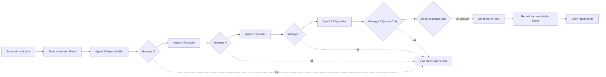

# AI Outreach Team for n8n

A team of AI agents that runs creator and cold email outreach end to end: it picks who to contact,
writes each email, reads the replies, pulls out prices and contacts, and keeps a Google Sheet up to date.
Every agent has a manager that checks its work, and nothing is sent unless every manager passes.

I built it for my own influencer marketing work and run it every day. This repository is a cleaned copy
of that live system, shared as a portfolio sample.

## What it does in one run

1. **Reads** both tabs of the Google Sheet (so human edits are kept) and the last days of Gmail.
2. **Reply Handler** reads every new reply with a free AI model, sorts it (rates sent, interested,
   question, not interested, auto reply, bounce) and drafts an answer for you.
3. **Recorder** updates the team memory: who was emailed, who is talking, who declined.
4. **Selector** picks today's people: never anyone already emailed, talking, declined or with a number,
   max 25 new a day, max 2 per company domain.
5. **Copywriter** writes each email from rotating openers and subjects, with the right questions.
6. **Senior Manager** opens the gate only if every manager passed. Then the emails go out one by one,
   about 5 a minute, both tabs of the sheet are rewritten and you get a daily report by email.



## Why it is built this way

- **Managers, not one long flow.** Each agent is a small script with one job. Its manager checks the
  result and stops the line on any problem, so a bad selection or a broken email never reaches a person.
- **Facts are never invented.** A price is kept only if every number in it is literally in the reply.
  Replies with screenshots are flagged for a human instead of guessed.
- **Humans win.** Anything typed into the sheet by hand is kept on every run.
- **Free models only.** Reply reading and the second opinion on drafts run on free tiers (Groq by
  default, any OpenAI compatible endpoint works). No paid model, no surprise bill.
- **Safe to click often.** A run lock allows one run at a time, the daily limit counts across runs,
  and a busy Gmail never stops the day: replies are picked up on the next run and follow ups wait.
- **You hear when it stops.** A separate error workflow emails which step stopped and the managers'
  own reasons.

## Results from my own use

- 8,028 creator records from 4 messy sources cleaned, merged and deduplicated into one sheet.
- 25 personalised first emails a day, sent automatically, never to someone already in touch.
- Replies turned into structured rows: rates, Telegram and phone numbers land in a "Ready to work" tab.
- 47 node workflow, validated with 0 errors, plus an error alert workflow tested end to end.

## The team

| Agent | Job | Its manager checks |
|---|---|---|
| 1 Selector | who gets an email today | limit, nobody twice, no one talking or declined |
| 2 Copywriter | writes each email | rule breaks, risky phrases, missing questions, links |
| 3 Reply Handler | reads replies, drafts answers | prices really in the email, contacts real |
| 4 Recorder | team memory and the sheet | no row lost, edits kept, talking people in Ready |
| 5 Senior Manager | final gate and daily report | every manager passed |

Each agent folder has an `AGENT.md` (job description, rules), `agent.py` (the work) and `manager.py`
(the check). Shared policy and playbooks live in `knowledge/`.

## Tech

n8n (self hosted), Python 3.12, Google Sheets and Gmail through n8n credentials, Gmail REST API for
sending and drafts, free LLM through `llm/engine.py`, optional email finding with Apify or Hunter.

## Folder map

```
agents/        5 agents, each with AGENT.md, agent.py, manager.py
scripts/       shared toolbox, workflow builder, n8n API helper, utilities
knowledge/     policy, email rules, negotiation playbook, team ethics
config/        settings (copy the example and fill it in)
llm/           free model adapter
examples/      fictional sample rows
```

## Setup in short

1. Run n8n (desktop or Docker) and create an API key. Add Gmail and Google Sheets credentials in n8n.
2. Copy `config/outreach_settings.example.json` to `config/outreach_settings.json` and fill it in.
3. Create `secrets.env` with `N8N_API_URL`, `N8N_API_KEY`, `GROQ_API_KEY`, `N8N_CRED_SHEETS_ID`,
   `N8N_CRED_GMAIL_ID`. It is in `.gitignore`.
4. Put your sheet ids in `data/sheets.json`, then build the workflow:
   `python -I scripts/build_team_workflow.py build`
5. Click Execute workflow in n8n, or let the daily schedule run it.

Start in `send_mode: draft` so you can read the first drafts before switching to automatic sending.

## Want one for your team?

I set this up for agencies and brands that run creator or cold email outreach from a sheet: your
sources, your rules, your voice, your credentials.

Portfolio: [shahmuhammadali.com](https://shahmuhammadali.com)

This code is shared as a portfolio sample. All rights reserved. Contact me for a build or a license.
